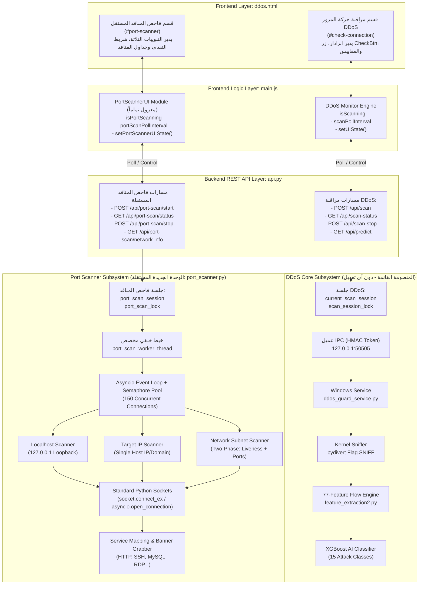

# خطة تنفيذ قسم فاحص المنافذ والشبكة (Port Scanner) المستقل في مشروع DDoS-Guard

---

## 1. نظرة عامة على الميزة والهدف العام (Overview & Goal)

يهدف هذا المشروع إلى إضافة وحدة أمنية جديدة متكاملة ومستقلة تماماً باسم **Port Scanner (فاحص المنافذ والشبكة)** داخل منصة **DDoS-Guard**. تتيح هذه الوحدة للمستخدم إجراء فحوصات استكشافية متقدمة للمنافذ والشبكات، مع الالتزام التام بالمبادئ التالية:

1. **الاستقلالية المعمارية والوظيفية المطلقة (Absolute Isolation):**
   فصل كامل بين وحدة **Port Scanner** ونظام **DDoS Monitoring** القائم. لا تشارك في الذاكرة، ولا في الخيوط (Threads)، ولا في متغيرات الجلسة، ولا في محركات الالتقاط أو التصنيف.
2. **محرك فحص داخلي خالص (Pure Python Engine):**
   الاعتماد الحصري على مكتبات بايثون القياسية المدمجة (`asyncio`, `socket`, `ipaddress`, `concurrent.futures`) **دون أي اعتماد على أدوات خارجية مثل Nmap أو Masscan أو Scapy**.
3. **توفير 3 أنماط فحص مرنة:**
   - **Localhost Scan:** فحص الجهاز المحلي (`127.0.0.1`) واكتشاف الخدمات النشطة فوراً.
   - **Target IP Scan:** فحص عنوان IP محدد أو اسم نطاق (IPv4/Domain) مع تحديد مرن للمنافذ والمهلة وسرعة الفحص.
   - **Network Scan:** اكتشاف ذكي للأجهزة النشطة داخل نطاق شبكة محلي (CIDR Subnet مثل `192.168.1.0/24`) وفحص منافذ الأجهزة المكتشفة فقط.
4. **واجهة مستخدم متناسقة ومستقلة (Cyber SOC Interface):**
   قسم خاص ومستقل داخل `ddos.html` ومحرك JavaScript منفصل تماماً داخل `main.js` يعمل دون مقاطعة أو التأثير على رادار أو دورة حياة مراقبة حركة المرور الحية.

---

## 2. ميثاق العزل التام وتحليل نقاط التداخل المحتملة (Strict Isolation Manifesto)

> [!CAUTION]
> **قواعد العزل الصارمة (Strict Boundary Rules):**
> 1. **ممنوع منعاً باتاً** استيراد أو استدعاء أو تعديل أيٍّ من: `current_scan_session` أو `scan_session_lock` أو `is_monitoring` داخل فاحص المنافذ.
> 2. **ممنوع منعاً باتاً** ربط فاحص المنافذ بكيرنل ويندوز، أو سائق `WinDivert`، أو خدمة ويندوز `ddos_guard_service.py`، أو عميل الـ IPC `ipc_client.py`، أو طلب صلاحيات UAC. فاحص المنافذ يعمل كلياً في فضاء المستخدم العادي (Standard User Space) عبر مقابس TCP القياسية.
> 3. **ممنوع منعاً باتاً** استدعاء نموذج الذكاء الاصطناعي `model` (XGBoost) أو الـ Scaler أو مستخرج الـ 77 ميزة `feature_extraction2.py` في أي خطوة من خطوات فحص المنافذ.
> 4. **الاستقلالية التزامنية الكاملة:** تشغيل، أو إيقاف، أو إلغاء فحص المنافذ لا يقطع ولا يغير ولا يعطل مراقبة الـ DDoS، والعكس صحيح تماماً؛ يمكن تشغيل الاثنين معاً بالتوازي بأمان تام.

### 2.1 جدول تحليل نقاط التداخل المحتملة (Conflict Points Analysis & Elimination):

| نقطة التداخل المحتملة في الكود الحالي | موقعها في الكود القائم | المخاطر في حال التداخل | المعمارية الوقائية المعتمدة للعزل التام |
| :--- | :--- | :--- | :--- |
| **متغير الجلسة العام `current_scan_session`** | [`api.py:103-119`](file:///d:/Projects/Grad%20project/api.py#L103-L119) | تعديل حالة فحص الـ DDoS، أو عرض نتائج بورتات بدلاً من تصنيف الهجمات في `/api/predict`. | إنشاء كائن جلسة وقفل خيطي مستقل تماماً باسم `port_scan_session` و `port_scan_lock` داخل المحرك الجديد مع عدم لمس متغيرات DDoS نهائياً. |
| **قفل الخيوط `scan_session_lock`** | [`api.py:102`](file:///d:/Projects/Grad%20project/api.py#L102) | حدوث Deadlock أو إعاقة دورة فحص حركة المرور الحية عند استغراق فحص البورتات لعدة ثوانٍ. | تخصيص قفل خيطي خاص `port_scan_lock = threading.Lock()` لا يتقاطع مع خيوط الـ DDoS إطلاقاً. |
| **مسارات الـ API العامة `/api/scan*`** | [`api.py:622,787,796`](file:///d:/Projects/Grad%20project/api.py#L622) | تضارب المسارات أو استدعاء إلغاء بالخطأ عبر دالة `stop_scan()`. | عزل مسارات فاحص المنافذ تحت بادئة مستقلة مخصصة: `/api/port-scan/*` بدون أي تقاطع مسارات. |
| **التقاط الحزم عبر كيرنل ويندوز (WinDivert)** | [`feature_extraction2.py`](file:///d:/Projects/Grad%20project/feature_extraction2.py) | تطلب صلاحيات Administrator، أو تعطل الخدمة إذا تم قفل الكيرنل. | الاعتماد على اتصالات المقابس المباشرة `socket.socket` و `asyncio.open_connection` دون استخدام أي مكتبة التقاط حزم أو سائق كيرنل. |
| **خدمة ويندوز ومقبس الـ IPC (`127.0.0.1:50505`)** | [`ddos_guard_service.py`](file:///d:/Projects/Grad%20project/ddos_guard_service.py) | تداخل في قنوات الاتصال، أو تشغيل أوامر خاطئة عبر الـ IPC. | عدم استخدام عميل الـ IPC (`ipc_client`) إطلاقاً داخل فاحص المنافذ؛ الاتصال يتم مباشرة بالهدف عبر الشبكة. |
| **نموذج الذكاء الاصطناعي (XGBoost) والـ 77 ميزة** | [`api.py:126-237`](file:///d:/Projects/Grad%20project/api.py#L126-L237) | تبديد موارد المعالج في استخراج 77 ميزة لعمليات فحص منافذ بسيطة، أو تضارب مخرجات التوقع. | فاحص المنافذ هو أداة شبكية كلاسيكية تحدد حالة البورت (`open`/`closed`/`filtered`) ولا تحتاج أي ذكاء اصطناعي أو مصفوفات 77 Features. |
| **متغيرات الـ Frontend في `main.js`** | [`static/main.js:14-19`](file:///d:/Projects/Grad%20project/static/main.js#L14-L19) | مشاركة متغير `isScanning` أو مؤقت `scanPollInterval` قد يوقف رادار الـ DDoS أو يعيد ضبطه عند فحص المنافذ. | بناء وحدة جافاسكريبت مغلفة بالكامل (`PortScannerUI`) بمتغيرات ومؤقتات استعلام (`portScanPollTimer`) ومعرفات DOM مسبوقة بـ `ps-` بشكل مستقل تماماً. |

---

## 3. المعمارية التقنية المستقلة (Independent Architecture)



---

## 4. تفاصيل الملفات الجديدة والمعدلة (File Changes & Implementations)

### 4.1 ملف جديد: `port_scanner.py` (محرك الفحص المستقل)
ملف بايثون مستقل لا يستورد أي مكون من مكونات الـ DDoS:
- **المكتبات المستخدمة:** `asyncio`, `socket`, `ipaddress`, `time`, `threading`, `typing`.
- **المكونات الأساسية:**
  - `COMMON_SERVICES`: جدول محلي يربط أكثر من 150 منفذاً شائعاً باسم الخدمة المقابلة.
  - `probe_single_port(ip, port, timeout)`: دالة Asyncio تحاول فتح اتصال TCP ثلاثي الاتجاهات، وفي حال النجاح تحاول قراءة ترويسة أولية للخدمة (Banner) بمهلة `0.3s`.
  - `scan_host_ports(ip, ports, timeout, semaphore, progress_callback)`: فحص قائمة منافذ لمضيف واحد مع تحديث دوري للتقدم المئوي.
  - `discover_alive_hosts(subnet_str, timeout, semaphore, progress_callback)`: المرحلة الأولى من فحص الشبكة؛ فحص سريع للمنافذ الحيوية (`80`, `443`, `445`, `135`, `22`) لاكتشاف الأجهزة الحية داخل نطاق الشبكة الفرعية دون تضييع الوقت على عناوين خاملة.
  - `PortScannerManager`: كلاس يدير حلقة الـ Asyncio داخل خيط خلفي (Dedicated Daemon Thread) ويوفر واجهات thread-safe لبدء الفحص، وجلب الحالة المرحلية، وإلغاء المهام فوراً عبر `task.cancel()`.

### 4.2 تعديل: `api.py` (إضافة الـ Endpoints المعزولة فقط)
- **المتغيرات الجديدة (المعزولة):**
```python
# Thread-safe Port Scanner Session Management (معزول تماماً عن current_scan_session)
port_scan_lock = threading.Lock()
port_scan_session = {
    "status": "ready",       # ready, scanning, completed, stopped, error
    "scan_id": None,
    "scan_type": None,       # localhost, target_ip, network
    "target": None,
    "started_at": None,
    "elapsed_time_s": 0.0,
    "progress_pct": 0.0,
    "scanned_ports": 0,
    "total_ports": 0,
    "open_ports_count": 0,
    "active_hosts_count": 0,
    "results": [],           # قائمة النتائج لكل جهاز ومنافذه المفتوحة
    "error": None,
    "message": "Ready to scan ports."
}
```

- **المسارات الجديدة المعزولة:**
  1. `POST /api/port-scan/start`: يستقبل نوع الفحص، الهدف، ونطاق المنافذ، ويتحقق من سلامة المدخلات ثم يبدأ الخيط الخلفي.
  2. `GET /api/port-scan/status`: يُرجع صورة من `port_scan_session` متضمنة التقدم والنتائج اللحظية.
  3. `POST /api/port-scan/stop`: يرسل إشارة إلغاء فورية لمحرك الـ Asyncio ويغير الحالة إلى `stopped`.
  4. `GET /api/port-scan/network-info`: يستخرج عنوان IPv4 المحلي ونطاق الـ Subnet المقترح تلقائياً لتسهيل فحص الشبكة على المستخدم.

### 4.3 تعديل: `templates/ddos.html` (إضافة قسم Port Scanner المستقل)
- إضافة رابط تنقل في القائمة الرئيسية:
  ```html
  <a href="#port-scanner" class="nav-link">Port Scanner</a>
  ```
- إضافة قسم كامل ومستقل `<section class="port-scanner-section" id="port-scanner">` يحتوي على:
  - شريط تبويب لاختيار النمط (`Localhost Scan`, `Target IP Scan`, `Network Subnet Scan`).
  - نموذج الإدخال (حقل الهدف المقيد، أزرار الاختيار السريع: Top 20, Top 100, Well-Known 1-1024, Custom Range).
  - إعدادات المهلة والسرعة.
  - أزرار التحكم المستقلة (`#psStartBtn`, `#psStopBtn`, `#psExportBtn`).
  - شريط التقدم اللحظي (`#psProgressBar`) ومؤشرات الإحصائيات (KPI Counters).
  - جدول المنافذ المفتوحة وبطاقات الأجهزة المكتشفة في الشبكة.

### 4.4 تعديل: `static/style.css` (تنسيقات القسم الجديد)
- إضافة أنماط بصرية سيبرانية متناسقة بالكامل مع السمة الداكنة للمشروع (`--bg-surface`, `--border-cyan`, `--accent-cyan`):
  - `.port-scanner-section`: تباعد وتصميم حاوية القسم.
  - `.ps-mode-tabs`: تصميم تبويبات التبديل الثلاثة مع تأثيرات النشاط والإضاءة.
  - `.ps-progress-track` و `.ps-progress-fill`: شريط تقدم متوهج ونابض بالحركة.
  - `.ps-port-badge`: شارات ملونة للمنافذ (`open` بالأخضر الزمردي، `closed` بالرمادي، `filtered` بالكهرماني).
  - `.ps-host-card`: بطاقات زجاجية للأجهزة المكتشفة قابلة للتوسيع والطي (Accordion).

### 4.5 تعديل: `static/main.js` (محرك الجافاسكريبت المستقل)
- إنشاء كائن مغلف بالكامل `PortScannerUI`:
  ```javascript
  const PortScannerUI = (() => {
    let portScanPollTimer = null;
    let isPortScanning = false;
    let currentMode = "localhost";
    
    // دوال مستقلة تماماً لا تستخدم أو تستدعي setUIState أو isScanning الخاصة بالـ DDoS
    function init() { ... }
    function switchMode(mode) { ... }
    async function startScan() { ... }
    async function stopScan() { ... }
    async function pollStatus() { ... }
    function renderResults(data) { ... }
    function exportResults(format) { ... }

    return { init };
  })();
  ```
- تشغيل `PortScannerUI.init()` عند تحميل الصفحة بشكل متوازي ومنفصل عن نظام مراقبة الـ DDoS.

---

## 5. قواعد الأمان وسلامة المدخلات (Security & Input Validation)

1. **التحقق من صحة الهدف (Target Sanitization):**
   - **Localhost:** يتم تثبيت القيمة برمجياً على `127.0.0.1` لمنع فحص أي هدف خارجي من خلال هذا النمط.
   - **Target IP:** التحقق الصارم من صحة العنوان عبر مكتبة بايثون `ipaddress.ip_address(target)`، مع منع أي محارف خاصة أو رموز قد تستخدم في حقن أوامر.
   - **Network Scan:**
     - التحقق عبر `ipaddress.ip_network(target, strict=False)`.
     - **تقييد الحجم الأقصى للشبكة:** رفض أي شبكة أكبر من قناع `/24` (أي بحد أقصى 256 عنوان IP) لمنع استنزاف موارد النظام.
     - **تقييد الفحص على النطاقات الخاصة:** حصر فحص الشبكة بالكامل على النطاقات المحلية الخاصة المعرفة في RFC 1918 (`10.0.0.0/8`, `172.16.0.0/12`, `192.168.0.0/16`) ورفض فحص نطاقات الإنترنت العامة عبر هذا النمط.
2. **التحقق من صحة المنافذ (Port Validation):**
   - حصر أرقام المنافذ في النطاق النظامي الصحيح من `1` إلى `65535`.
   - فحص الصيغ المدخلة (أرقام مفردة أو نطاقات مثل `80-443` أو قوائم مفصولة بفواصل) والتأكد من ترتيب `start <= end`.
   - وضع حد أقصى للمنافذ المفحوصة في الجلسة الواحدة (مثلاً 2000 منفذ) لتفادي حظر المقابس أو إثقال الشبكة.
3. **حماية موارد النظام من نفاد المقابس (Socket Exhaustion Prevention):**
   - استخدام `asyncio.Semaphore(150)` للحد الصارم من عدد الاتصالات المفتوحة في اللحظة الواحدة.
   - إغلاق المقابس بصورة صريحة وفورية عبر كتل `try...finally` مع استدعاء `writer.close()` و `await writer.wait_closed()`.
   - تطبيق مهلة استجابة قصيرة ومحكمة (افتراضياً `0.5s`) لمنع تعليق المهام على المنافذ المفلترة بجدران الحماية.

---

## 6. مراحل التنفيذ التفصيلية (Step-by-Step Implementation Phases)

### المرحلة 1: إنشاء محرك الفحص المستقل `port_scanner.py`
- إنشاء الملف الجديد وكتابة كلاسات الفحص غير المتزامن وقاموس الخدمات الـ 150+.
- بناء آليات التقاط البانر ومعالجة الأخطاء والـ Timeouts.
- كتابة اختبار وحدة أولي للتأكد من فحص المنافذ واكتشاف الخدمات دون استيراد أي ملف آخر من المشروع.

### المرحلة 2: دمج المسارات المعزولة في `api.py`
- إضافة كائن الجلسة `port_scan_session` وقفل التزامن `port_scan_lock`.
- إضافة مسارات `/api/port-scan/*` مع التحقق الصارم من المدخلات.
- التأكد من عدم تعديل أو استدعاء أي كود يخص نموذج XGBoost أو WinDivert أو جلسة الـ DDoS.

### المرحلة 3: بناء قسم الواجهة في `templates/ddos.html` و `static/style.css`
- إضافة رابط القائمة والقسم المستقل في ملف الـ HTML بمعرفات فريدة مسبوقة بـ `ps-`.
- تصميم الأزرار، التبويبات، حقول الإدخال، شريط التقدم، والجداول وفقاً لنظام الألوان السيبراني الداكن.

### المرحلة 4: ربط المنطق التفاعلي في `static/main.js`
- برمجة وحدة `PortScannerUI` المستقلة.
- ربط أحداث تبديل الأنماط والتحقق من صحة المدخلات في المتصفح.
- برمجة الاستعلام الدوري (Polling) كل 300ms أثناء الفحص وتحديث الجداول لحظياً.
- برمجة وظيفة تصدير النتائج بصيغة JSON و CSV.

### المرحلة 5: الاختبارات الشاملة وضمان عدم التراجع (Verification & Regression Testing)
- إنشاء ملف اختبارات جديد `test_port_scanner.py` للتحقق من كافة سيناريوهات فحص المنافذ.
- تشغيل اختبارات منظومة الـ DDoS الحالية للتأكد من اجتيازها بنسبة 100%:
  - `python test_service_architecture.py` (7 اختبارات)
  - `python test_scan_flow.py` (7 اختبارات)
- اختبار تشغيل فحص DDoS وفحص Port Scanner في نفس اللحظة للتأكد عملياً من عدم حدوث أي تداخل.

---

## 7. خطة الاختبار ومعايير القبول (Verification Plan & Acceptance Criteria)

### 7.1 الاختبارات الآلية (Automated Verification):
```powershell
# 1. اختبارات فاحص المنافذ الجديد (التأكد من الأنماط الثلاثة، معالجة الأخطاء، وإلغاء المهام)
python -m unittest test_port_scanner.py -v

# 2. التأكد التام من استقرار وعدم انحدار منظومة كشف DDoS القائمة (7/7 اختبارات ناجحة)
python test_service_architecture.py

# 3. التأكد من سلامة تدفق فحص DDoS وحالة السيرفس (7/7 اختبارات ناجحة)
python test_scan_flow.py
```

### 7.2 الاختبارات التزامنية اليدوية (Concurrent Live Verification):
1. **فحص الجهاز المحلي (Localhost Scan):**
   - بدء فحص Localhost للمنافذ الشائعة Top 20.
   - التحقق من اكتشاف منفذ Flask النشط (`5000`) وحالته `OPEN` والخدمة المقابلة.
2. **فحص هدف محدد (Target IP Scan):**
   - فحص عنوان محدد في الشبكة لنطاق مخصص مثل `80, 443, 8080`.
   - التحقق من دقة النتائج وعرض شريط التقدم بنسبة مئوية صحيحة.
3. **فحص الشبكة (Network Scan):**
   - اختيار فحص الشبكة، والتأكد من اقتراح النطاق الفرعي تلقائياً (مثل `192.168.1.0/24`).
   - التحقق من مرحلة اكتشاف الأجهزة النشطة أولاً، ثم حصر فحص المنافذ عليها فقط.
4. **اختبار الإلغاء الفوري (Immediate Stop Test):**
   - بدء فحص نطاق واسع ثم النقر فوراً على "Cancel Scan".
   - التأكد من توقف الفحص خلال أقل من ثانية وتغيير الحالة إلى `Stopped`.
5. **اختبار عدم التداخل الحاسم (The Concurrency Isolation Test):**
   - تشغيل **Live DDoS Scan** عبر زر `Scan Network` الرئيسي.
   - في نفس الوقت تماماً، الانتقال لقسم **Port Scanner** وتشغيل فحص **Localhost Scan**.
   - **معيار القبول:** يعمل الفحصان معاً في نفس الوقت، يكتمل فحص الـ DDoS ويعرض تصنيف حركة المرور والـ 77 Features ونموذج الـ AI، ويكتمل فحص المنافذ ويعرض جدول البورتات والخدمات، دون أن يؤثر أحدهما على بيانات أو مؤشرات أو دورة حياة الآخر مطلقاً.

---

## 8. جدول ملخص الملفات والتعديلات (Files Summary)

| الملف | الحالة | نوع التغيير والدور في المنظومة |
| :--- | :--- | :--- |
| `port_scanner.py` | **[جديد - NEW]** | محرك الفحص المستقل كلياً باستخدام مكتبات بايثون القياسية (`asyncio`, `socket`, `ipaddress`). |
| `test_port_scanner.py` | **[جديد - NEW]** | حزمة اختبارات مؤتمتة للأنماط الثلاثة والتحقق من صحة المدخلات وإلغاء المهام. |
| `api.py` | **[تعديل - MODIFY]** | إضافة مسارات الـ REST API الأربعة تحت بادئة `/api/port-scan/*` وجلسة `port_scan_session` دون المساس بكود الـ DDoS. |
| `templates/ddos.html` | **[تعديل - MODIFY]** | إضافة رابط Navbar وقسم الـ HTML المستقل للـ Port Scanner بمعرفات مخصصة `ps-*`. |
| `static/style.css` | **[تعديل - MODIFY]** | إضافة التنسيقات البصرية والزجاجية المتناسقة للقسم الجديد وشريط التقدم وبطاقات الأجهزة. |
| `static/main.js` | **[تعديل - MODIFY]** | إضافة وحدة `PortScannerUI` المعزولة بمؤقتاتها وأحداثها المستقلة عن محرك فحص الـ DDoS. |
